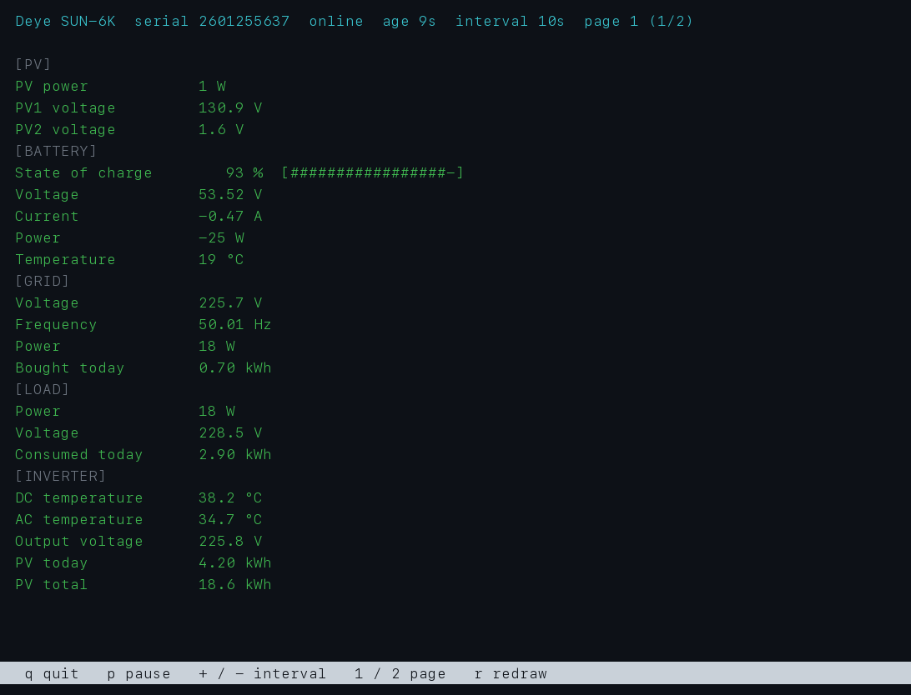
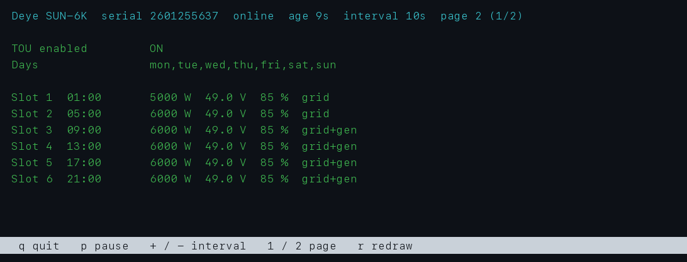
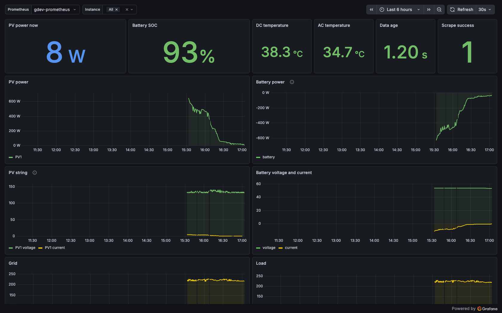
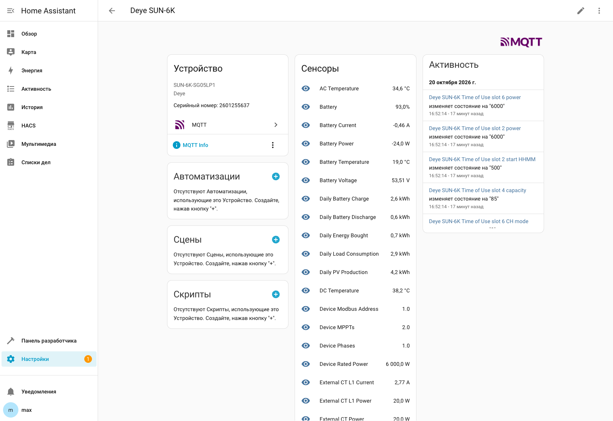
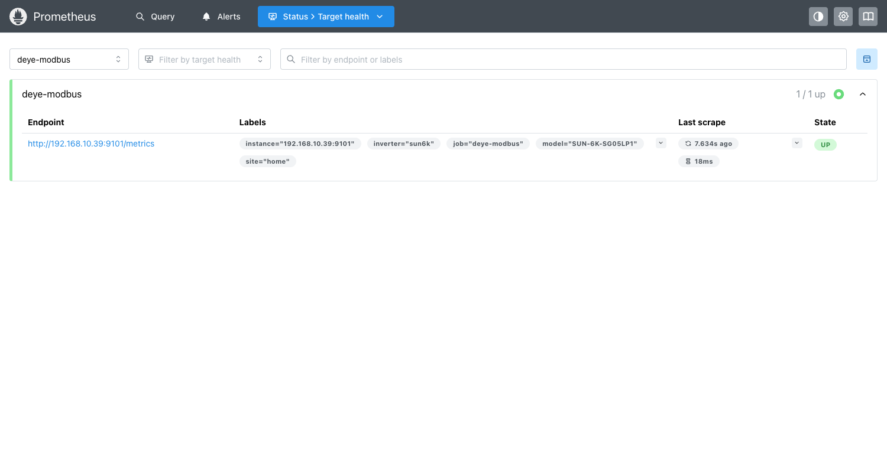

# DEYEMonitoring

Read-only Modbus RTU monitoring for a Deye hybrid inverter (validated on `SUN-6K`, single phase)
running on a Raspberry Pi over a Waveshare USB↔RS232/485 adapter.

The service only ever issues Modbus function code `03` (read holding registers). There are no
write paths in the code, so the inverter cannot be reconfigured by mistake.

## Hardware

| Part | Notes |
|---|---|
| Raspberry Pi (8 GB, Debian 13 / trixie) | `deye-monitoring`, `192.168.10.39` |
| Waveshare `USB TO RS232/485 (B)`, SKU 26547 | FTDI FT232RNL, isolated, auto direction control |
| Deye inverter | Modbus port is the RJ45 socket labelled **`Modbus`** |

Wiring (official Deye pinout, manual page 53):

| Deye Modbus RJ45 | Waveshare terminal |
|---|---|
| Pin 1 — `sunspe-485_B` | `B-` |
| Pin 2 — `sunspe-485_A` | `A+` |
| Pin 3 — `GND_sunspe-485` | `PE` / GND (optional, recommended for runs over ~5 m) |

Pins 4–8 stay unconnected. Use one twisted pair for A/B (pins 1 and 2 are one pair in T568B),
keep the 120 Ω termination jumper **off** for a short two-node line, and never take power from
the RJ45 port. If there is no reply, swap A and B first — RS485 polarity is not standardised
between vendors and swapping is harmless.

Serial settings: `9600 8N1`, slave address `1` (`Advanced Function → Paral. Set3 → Modbus SN`).

## Install on the Pi

```bash
# uv
curl -LsSf https://astral.sh/uv/install.sh | sh

# stable device name: FTDI serial BG03RO6W -> /dev/modbus
sudo tee /etc/udev/rules.d/99-deye-modbus.rules >/dev/null <<'RULE'
SUBSYSTEM=="tty", KERNEL=="ttyUSB[0-9]*", ATTRS{idVendor}=="0403", ATTRS{idProduct}=="6001", ATTRS{serial}=="BG03RO6W", ENV{ID_MM_DEVICE_IGNORE}="1", SYMLINK+="modbus", GROUP="dialout", MODE="0660"
RULE
sudo udevadm control --reload-rules && sudo udevadm trigger --subsystem-match=tty
```

The user must be in the `dialout` group to open the port without root.

## Usage

```bash
uv run dmon read          # human readable table, one snapshot
uv run dmon json          # one JSON line (ready for logs or an ingest pipeline)
uv run dmon dump          # raw holding registers, 8 words per line
uv run dmon watch         # poll forever, one JSON line per cycle
uv run dmon watch --interval 5 --human
```

Options common to every command: `--port` (default `/dev/modbus`), `--baud` (9600),
`--slave` (1), `--timeout` (1.0 s). They can also be set with `DEYE_PORT`, `DEYE_BAUD`,
`DEYE_SLAVE`.

Example JSON line:

```json
{"timestamp": "2026-10-20T14:58:03+00:00", "serial": "2601255637",
 "values": {"PV1 Power": 654, "PV1 Voltage": 130.9, "Battery": 89, "Grid Power": 18}}
```

## Configuration

One file configures both services: `/etc/deye-monitoring.env` (systemd `EnvironmentFile`). Copy
`deploy/systemd/deye-monitoring.env.example`, `chmod 600`, then restart the services. Every key is
optional and falls back to the default shown.

| Variable | Default | Used by |
|---|---|---|
| `DEYE_PORT` | `/dev/modbus` | both |
| `DEYE_BAUD` / `DEYE_SLAVE` | `9600` / `1` | both |
| `DEYE_LISTEN` | `0.0.0.0:9101` | collector |
| `DEYE_INTERVAL` | `10` | collector |
| `DEYE_CACHE_PATH` | `/run/deye/state.json` | collector writes, publisher reads |
| `DEYE_NOTIFY` | off | collector (`1` enables Telegram) |
| `DEYE_LOG_LEVEL` | `INFO` | both |
| `DEYE_TELEGRAM_TOKEN` / `DEYE_TELEGRAM_CHAT_ID` | — | collector |
| `DEYE_TEMP_WARNING_C` / `DEYE_STALE_SECONDS` / `DEYE_NOTIFY_COOLDOWN` | `65` / `120` / `1800` | collector |
| `DEYE_MQTT_HOST` / `DEYE_MQTT_PORT` | `192.168.10.68` / `1883` | publisher |
| `DEYE_MQTT_USER` / `DEYE_MQTT_PASSWORD` | — | publisher |
| `DEYE_MQTT_PREFIX` / `DEYE_MQTT_NODE` | `homeassistant` / `deye_6k` | publisher |

Because the cache path lives here, both units can start without any flags:

```ini
# deye-monitoring.service
ExecStart=/home/max/DEYEMonitoring/.venv/bin/dmon serve

# deye-mqtt.service
ExecStart=/home/max/DEYEMonitoring/.venv/bin/dmon publish
```

## Run as a service

Two units, one per role:

| Unit | Role | Owns the serial port |
|---|---|---|
| `deye-monitoring.service` | polls the inverter, writes the cache, serves `/metrics` | **yes** |
| `deye-mqtt.service` | reads the cache, publishes to MQTT | no |

Unit files live in [`deploy/systemd/`](deploy/systemd/), the environment template in
[`deploy/systemd/deye-monitoring.env.example`](deploy/systemd/deye-monitoring.env.example).

```bash
sudo install -m 0644 deploy/systemd/deye-monitoring.service /etc/systemd/system/
sudo install -m 0644 deploy/systemd/deye-mqtt.service /etc/systemd/system/
sudo systemctl daemon-reload
sudo systemctl enable --now deye-monitoring
systemctl status deye-monitoring
journalctl -u deye-monitoring -f
```

If the unit failed several times while you were setting it up, systemd refuses further starts;
clear the counter with `sudo systemctl reset-failed deye-monitoring`.

Why the unit looks the way it does:

- `ExecStart` points at the venv entry point (`.venv/bin/dmon`), not at `uv run`. The venv script
  is a `/bin/sh` trampoline, so SIGTERM reaches the collector and it stops cleanly instead of
  leaving the serial port locked.
- `WorkingDirectory=/home/max` is only there for a predictable cwd; every path the service uses
  is absolute.

Optional settings live in `/etc/deye-monitoring.env` (`DEYE_LISTEN`, `DEYE_INTERVAL`,
`DEYE_PORT`, Telegram variables); every one of them has a built-in default.

## Telegram alerts

Built in, no Prometheus or Alertmanager required. Put the credentials in `/etc/deye-monitoring.env`
and restart the service:

```bash
sudo tee /etc/deye-monitoring.env >/dev/null <<'ENV'
DEYE_TELEGRAM_TOKEN=123456:AA-your-token
DEYE_TELEGRAM_CHAT_ID=123456789
ENV
sudo systemctl restart deye-monitoring
journalctl -u deye-monitoring -n 5 | grep telegram
```

| Variable | Default | Meaning |
|---|---|---|
| `DEYE_TELEGRAM_TOKEN` | — | bot token from `@BotFather`; without it notifications stay off |
| `DEYE_TELEGRAM_CHAT_ID` | — | chat or channel id (see `getUpdates` after writing to the bot) |
| `DEYE_TEMP_WARNING_C` | `65` | DC/AC temperature that raises an alert |
| `DEYE_STALE_SECONDS` | `120` | data age that counts as stale |
| `DEYE_NOTIFY_COOLDOWN` | `1800` | minimum seconds between repeats of the same alert |

Alerts: Modbus reads failing, stale data, over-temperature, running status `fault`, status `alarm`.
A `RECOVERED` message is sent when an alert clears, and a cooldown keeps a flapping line from
spamming the chat. Without a token the service logs `telegram disabled` and keeps monitoring.

## MQTT / Home Assistant

The collector owns the serial port and writes a JSON snapshot to `/run/deye/state.json` (tmpfs,
atomic replace) after every poll. Anything else reads that file or the HTTP endpoint, so the
Modbus bus never sees two masters.

Two ways to publish:

```bash
dmon serve --mqtt          # one process: metrics + MQTT
dmon publish               # separate service: reads the cache, no serial access
```

The split (`deye-mqtt.service` on top of `deye-monitoring.service`) is what the repo ships: a
crash or restart of the publisher cannot disturb the collector, and vice versa. When the cache is
missing or older than `3 x interval`, the publisher marks the device `offline` instead of
republishing stale numbers.

```bash
uv run dmon mqtt --broker 192.168.10.68 --interval 10        # MQTT only
uv run dmon serve --mqtt                                    # metrics + MQTT in one process
```

| Variable | Default | Meaning |
|---|---|---|
| `DEYE_MQTT_HOST` | `192.168.10.68` | broker address |
| `DEYE_MQTT_PORT` | `1883` | broker port |
| `DEYE_MQTT_USER` / `DEYE_MQTT_PASSWORD` | — | credentials, if the broker requires them |
| `DEYE_MQTT_PREFIX` | `homeassistant` | discovery prefix |
| `DEYE_MQTT_NODE` | `deye_6k` | node id used in topics and unique ids |

Topics:

- `deye/state` — retained JSON: `{"timestamp", "serial", "online", "values": {...}}`;
- `deye/availability` — `online` / `offline`, with a last-will so a crash is visible;
- `homeassistant/sensor/deye_6k/<unique_id>/config` — retained discovery config per sensor.

Home Assistant picks the entities up automatically as a `Deye SUN-6K` device; no YAML needed.
Discovery is generated from the values actually published. The cache therefore keeps zero-valued
registers: a sensor that happens to read 0 W (PV at night, idle load) must stay in the registry
instead of disappearing until sunrise.

Two gotchas worth remembering:

- the state template uses subscripts — `{{ value_json['values']['PV1 Power'] }}` — because
  `value_json.values` resolves to the dict method `values()` and silently breaks every sensor;
- after renaming or dropping sensors, remove the stale retained configs with
  `uv run python tools/cleanup_discovery.py`, otherwise Home Assistant keeps "unavailable"
  entities forever.

## Live console (htop style)

```bash
uv run dmon top            # full-screen dashboard, refresh every 2 s
uv run dmon top --once     # one frame as plain text (useful over a slow link or in a script)
```

It reads the local cache, so it works over any SSH session and never competes with the service for
the serial port. Sections: PV, battery (with a gauge), grid, load, inverter temperatures, plus the
Time-of-Use schedule on the second page.

| Key | Action |
|---|---|
| `q` | quit |
| `p` | pause / resume |
| `+` / `-` | change refresh interval |
| `1` / `2` | overview / Time-of-Use page |
| `r` | force redraw |

Colour thresholds: battery below 25 % is yellow, below 15 % red; DC/AC temperature above 60 °C
yellow, above 70 °C red; grid frequency outside 49–51 Hz yellow.

### Screenshots

Overview page — PV, battery gauge, grid, load and inverter temperatures:



Time-of-Use page (`2`) — six slots with start, power, target voltage, SoC and charge sources:



Grafana dashboard fed by the exporter (`deye-6k`, 15 panels):



The same data as a Home Assistant device, created by MQTT discovery — no YAML, serial number and
activity included:



Prometheus sees the exporter as a normal target (`deye-modbus`, scrape 30 s, last scrape 18 ms):



The terminal frames are generated from live cache data with
`uv run --with pillow python tools/render_tui_png.py docs/assets/dmon-top.png docs/assets/dmon-top-tou.png`
so they can be refreshed after a layout change.

## Writing (Time-of-Use)

Monitoring stays read-only. Changing the schedule is a separate, explicit command:

```bash
uv run dmon-write list                                        # current values, read-only
uv run dmon-write plan tou.1.power=5500                       # validate only
uv run dmon-write set tou.1.power=5500 --confirm              # write + readback + audit
uv run dmon-write verify tou.1.power=5500                     # read-only drift check
```

Every write is range-checked, read back from the inverter and appended to
`/var/log/deye/writes.log`. Bit targets (grid/gen charge) use read-modify-write so the GM/BU/CH
bits survive. See [docs/WRITES.md](docs/WRITES.md) for the allow-list, formats and exit codes.

## Register map

`src/deye_monitoring/registers.py` is generated — do not edit it by hand:

```bash
uv run python tools/generate_registers.py
```

The source definitions are vendored in `tools/upstream-map/` from
[scrhall/deye-sun6k-waveshare-esphome](https://github.com/scrhall/deye-sun6k-waveshare-esphome)
(Apache-2.0), which itself derives from `Lewa-Reka/esphome-deye-inverter`. Every sensor is
read-only: write entities are excluded upstream and the generator only emits numeric
`holding` registers.

Decoding rules per register: `value_type` (`U_WORD`, `S_WORD`, `U_DWORD`, `U_DWORD_R`),
`scale`, `offset` and optional bit extraction (`shift`, `mask`). Registers whose value is zero
are hidden from output to keep JSON lines short — see `snapshot.decode`.

## Development

```bash
uv sync                 # install pyserial + dev tools
uv run pytest           # unit tests, uses tests/fixtures/raw_registers.json
uv run ruff check .
uv run ruff format .
```

The fixture is a real snapshot captured from the inverter, used to pin decoding behaviour:
serial number, 32-bit word-swapped rated power, temperature offset, bit-field registers.

## Layout

```
src/deye_monitoring/
  modbus.py      # FC3 client, CRC-16, retries, exception frames
  registers.py   # generated register map (63 registers)
  snapshot.py    # block reads, decoding, serial number
  enums.py       # status enums (running status)
  cli.py         # read / json / dump / watch / serve
  tou.py         # Time-of-Use decoder (slots, charge bits)
  write.py       # guarded writes, allow-list, readback, audit
  write_cli.py   # dmon-write list / plan / set
  mqtt.py        # state + Home Assistant discovery
  tui.py         # dmon top dashboard
tools/
  generate_registers.py  # regenerates registers.py from the vendored map
  upstream-map/*.yaml    # vendored ESPHome register definitions
tests/
```
