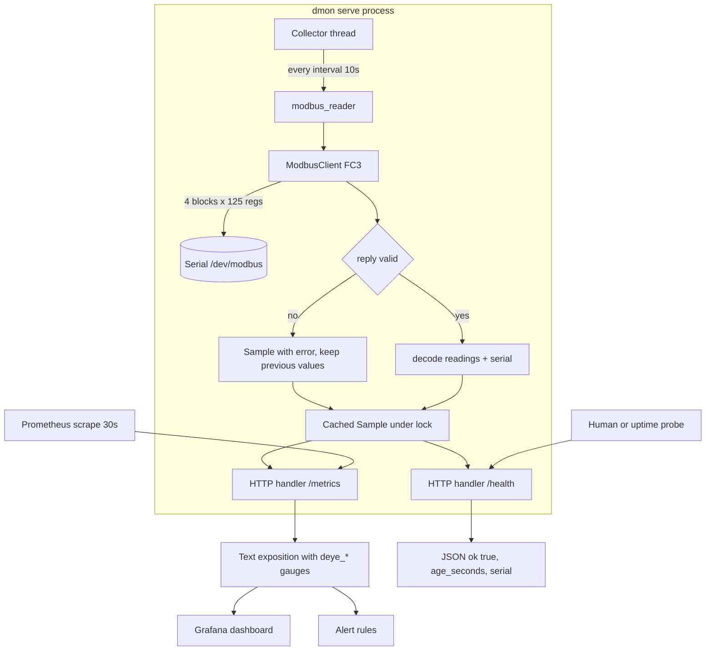
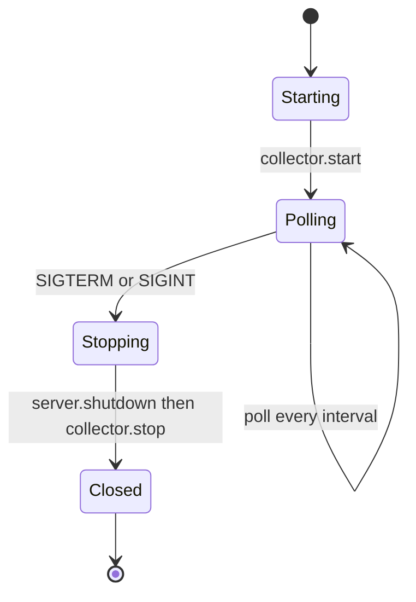

# Exporter service flow

Runtime shape of `dmon serve`: one thread owns the RS485 line, the HTTP layer only reads the
cached snapshot. This is what prevents a Prometheus scrape from colliding with a Modbus poll on
a single-master bus.

Shutdown path, so no orphaned process keeps the serial port locked:

