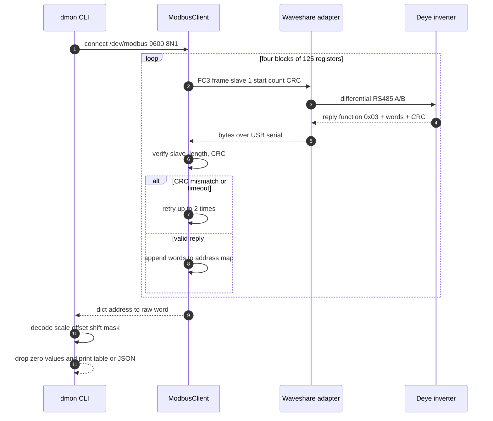
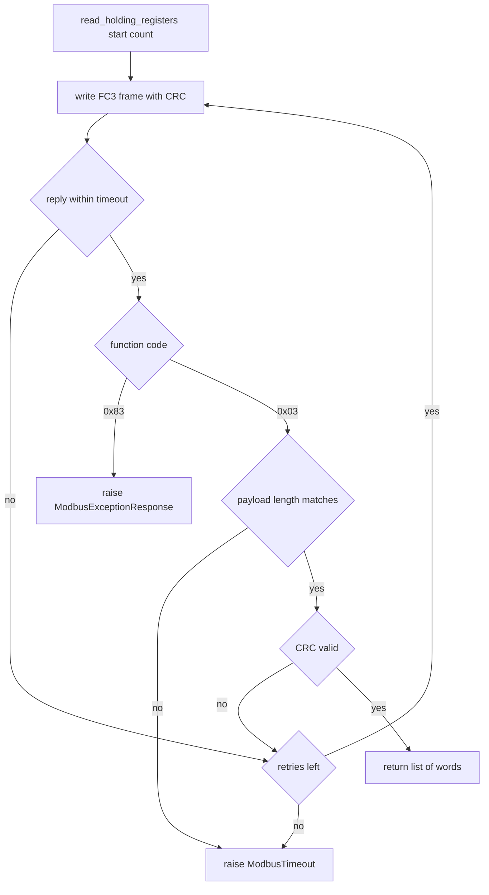
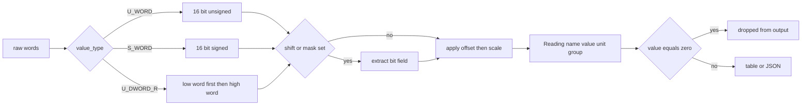

# Modbus read flow

How one `dmon read` / `dmon json` / `dmon watch` cycle moves data from the inverter into a
decoded snapshot. Read-only by construction: only function code `0x03` is ever sent.

Decision path inside the client, per register block:

Snapshot decoding:

