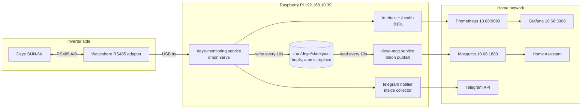
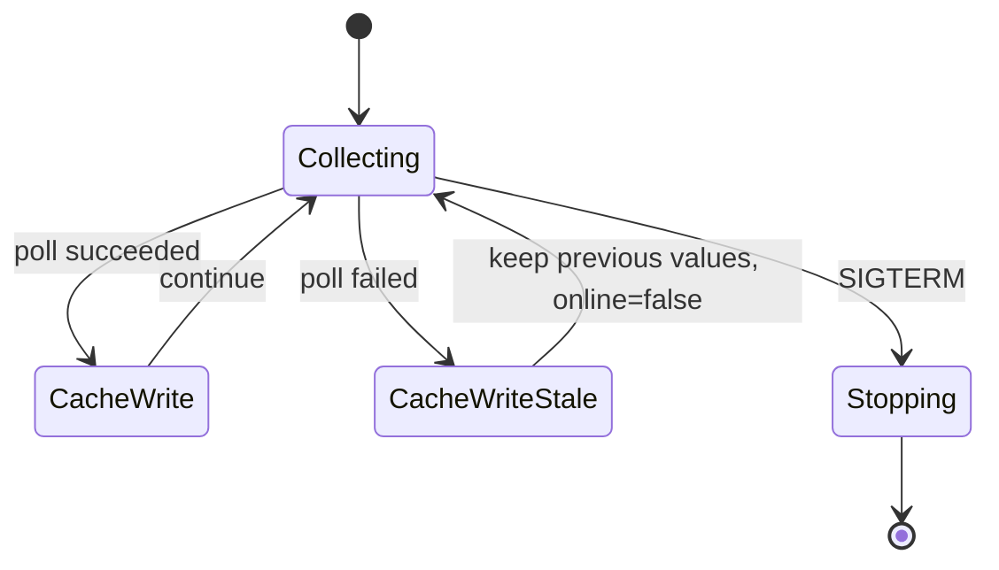
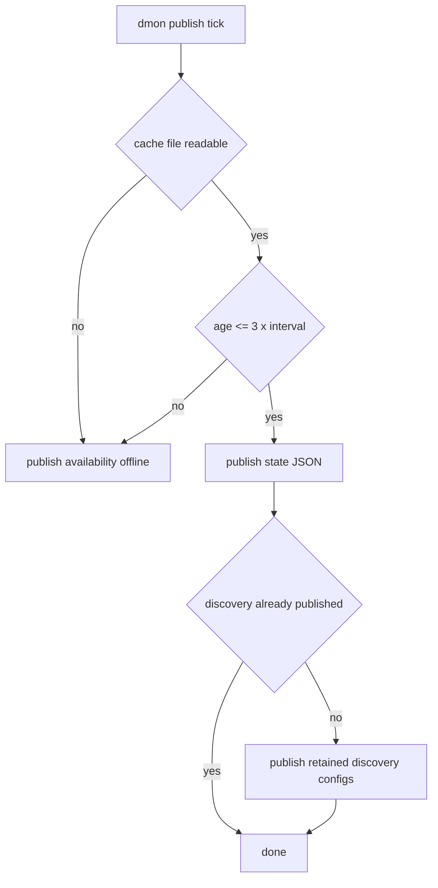

# Service topology

Two services on the Pi share one RS485 line through a local JSON cache. Only the collector opens
`/dev/modbus`; everything else reads either the cache file or the HTTP endpoint.

Why the cache exists: the Modbus bus allows one master. Two processes reading the inverter would
collide, so the collector owns the port and publishes a snapshot instead of sharing the device.

Consumer behaviour when the cache is missing or old (`age > 3 x interval`):

