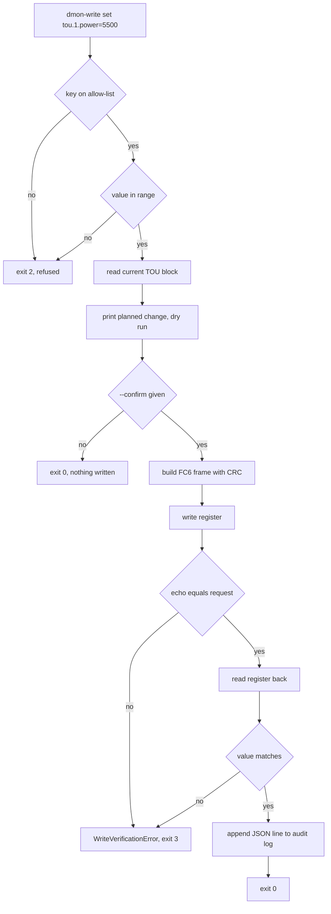
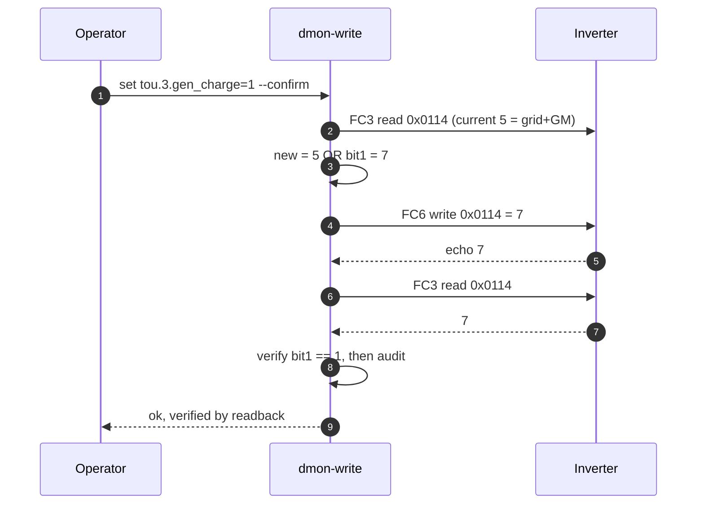
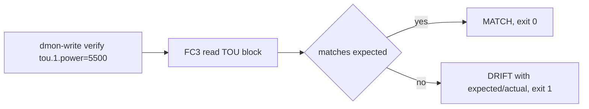

# Guarded write flow

How `dmon-write` moves from a human intention to a verified register change. Read-only monitoring
is untouched by this path: the module is not imported by `dmon serve`.

Bit targets (grid/gen charge) add a read-modify-write step so the GM/BU/CH bits survive:

Verification without writing, used before trusting an automation or after a manual change on the
inverter screen:

